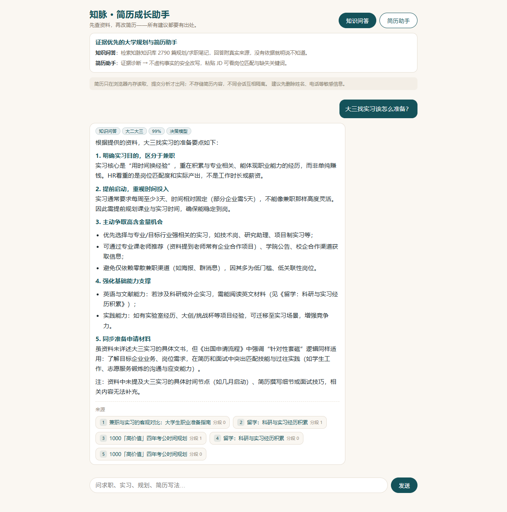
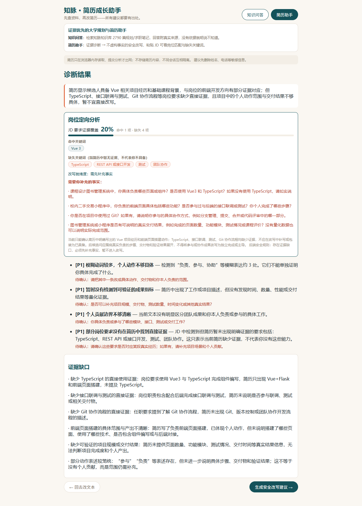
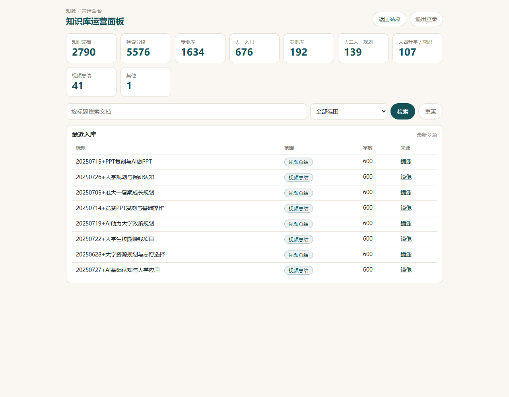
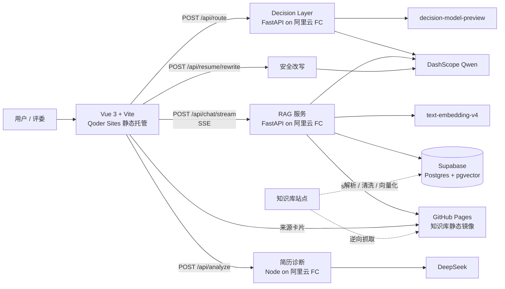
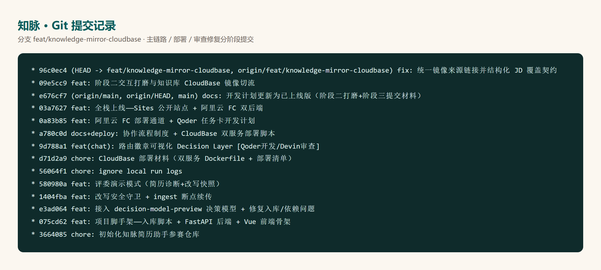

# 知脉 · 简历成长助手

> **证据优先的大学规划与简历助手**
> 先查资料，再改简历——所有建议都要有出处。

**在线体验**：https://zhimai-resume-uxvajmzewfe.qoder.zone
**代码仓库**：https://github.com/lzjzj-creator/aliyun （`main`，提交 `3a39c90`）

---

## 一、为什么做这个

大学生真正缺的往往不是“努力”，而是**信息差**：不知道大一该补什么、什么时候找实习、保研和秋招怎么排、简历里的经历怎样写才有说服力。

通用 AI 能给出看似完整的答案，但有两个致命问题：

1. **没有出处**：政策、时间线、结论可能是模型编的，学生无法核验；
2. **改简历时容易虚构**：为了“好看”擅自加数字、加职责，反而埋下面试翻车风险。

知脉把这两件事拆开解决：**先用可追溯的知识库回答规划问题，再用不虚构事实的流程改简历**。回答不出就明说，缺数据就反问，不拿模型幻觉冒充事实。

## 二、产品功能

### 1. 知识问答：答案带真实来源

- 覆盖 **2790 篇**大学规划 / 实习 / 求职笔记，切成 **5576 个**向量分段；
- 混合检索后流式生成，回答下方展示来源卡片，可点开原文核对；
- 检索分不足阈值时直接说明“知识库里没有资料”，不硬编；
- 顶部路由徽章展示意图、知识域、置信度与决策层来源，评委能直接看到 Agent 的判断过程。



### 2. 简历助手：证据诊断 → 安全改写

- 支持粘贴或上传简历，规则引擎 + DeepSeek 双引擎诊断；
- 粘贴 JD 后展示岗位匹配度、命中关键词与缺失关键词；
- STAR 改写遵守三条红线：不新增事实、缺数据用占位符、所有新数字必须反问确认；
- 后端确定性守卫会扫描建议文本中的数字，原文没有的数字强制标记为“待用户确认”。



### 3. 评委演示模式

首页提供「演示问答」按钮，加载一条真实 RAG 响应快照并逐字回放。弱网或 API 冷启动时也能稳定展示完整效果，不消耗模型配额。

### 4. 隐藏的管理后台

公开站保持开放评审；管理入口只通过 `#admin` 进入，使用单一管理员密码 + 服务端签名会话，可查看文档/分段统计、按标题检索知识库。密码校验、失败限流与令牌签发全部在后端完成，不在前端硬编码。



## 三、整体架构



前端、两个后端与知识库镜像全部独立部署；模型与数据库密钥只存在服务端环境变量中。

## 四、技术亮点

### 1. 级联决策路由，而不是“一个问题一个接口”

`Decision Layer` 先走 L1 规则快通道（空输入、寒暄、附件、简历关键词），未命中再调用 L3 `decision-model-preview` 输出结构化意图、知识域、置信度与澄清概率。前端根据 `action` 自动分流：

- `answer` → 进入 RAG；
- `guide_resume` → 引导到简历助手；
- `clarify` → 生成二选一反问；
- `refuse` → 超范围直接拒答。

L2 语义路由层保留为后续扩展，不为了“三层”而堆砌未使用的能力。

### 2. 数字溯源守卫：不依赖模型自觉

改写结果返回后，后端用正则提取建议文本中的全部数字，与原文、用户已确认事实取差集。任何原文没有的数字都会：

1. 强制把该条目标记为 `needs_user_data=true`；
2. 自动生成确认问题，要求用户提供准确数据；
3. 不允许把占位估计当成真实成果。

这是**确定性代码约束**，即使模型“想编”也会被拦下。

### 3. 证据优先拒答

RAG 在生成前检查最高检索分，低于 `MIN_RETRIEVE_SCORE` 直接返回资料不足提示，不调用模型编答案。提示词同时约束“只根据给定资料回答”。

### 4. 断点续传的知识库入库

2790 篇文档的 embedding 结果按批写入 `data/embed_cache.jsonl`，重跑时按 chunk key 跳过已算向量；文档与分段入库也做增量跳过。网络中断或额度波动后可以从断点继续，而不是全量重跑。

### 5. 知识库逆向重建与来源解耦

为了让产品输出不暴露原知识库站点，项目把公开知识库重建为本地静态镜像，并发布到 GitHub Pages：

- 保留中文原始路径，目录页统一落为 `index.html`；
- 统一处理 URL 解码、零宽字符、`/index` 与 `/index/index.html` 等历史脏路径；
- 后端与前端共用同一套映射规则，2790 篇文档逐条校验 0 缺失；
- 镜像 HTML 使用绝对根路径，因此部署在 Pages 用户站根仓库，并用 `.nojekyll` 保留静态文件；
- 产品内所有来源链接只指向镜像，前端、接口和镜像 HTML 都不出现原站域名；评委点击来源直达正文，不再经过测试域名风险提醒页。

### 6. JD 覆盖分析采用结构化契约

简历诊断服务返回 `job_coverage`（总数 / 命中 / 缺失 / 百分比），前端不再用正则猜文本，直接渲染结构化字段；缺失关键词、匹配度与改写就绪度分区展示。

## 五、评测结果

评测脚本与完整数据见 [评测报告](评测报告.md)。

| 评测 | 结果 |
|---|---|
| 路由 30 条标注用例 | 29 正确，准确率 **96.7%**（连续 3 次稳定） |
| RAG 10 条知识问题 | **10/10** 来源非空且最高分 > 0.25 |
| 来源域名 | 100% 指向 GitHub Pages 镜像，原站域名 0 次 |

路由的唯一误差集中在「天气 / 影视推荐」这类超范围问题的闲聊/超范围边界；即使误判为闲聊，进入问答后仍会因检索分不足而拒答，不会拿知识库内容硬答无关问题。

## 六、Qoder 开发过程

项目按任务卡拆分推进，每张卡都有明确的输入、验收标准与改动边界：

1. **核心链路**：知识库入库 → 混合检索 → 流式问答 → Decision Layer → 简历诊断/改写；
2. **体验打磨**：Markdown 渲染、来源卡片、演示快照、移动端适配、JD 覆盖区块、首页引导；
3. **上线与解耦**：Qoder Sites 发布、阿里云 FC 双后端、GitHub Pages 知识库镜像、来源域名清洗；
4. **审查修复**：Devin 审 diff，修复零宽字符 404、悬停域名泄露、JD 字段硬编码、URL 规则重复、FC 网关下限流 IP 识别等问题；
5. **评测与运营**：路由/RAG 评测脚本、管理后台、线上回归。

Qoder 会话记录保存在本机 `C:\Users\Lenovo\.qoder-cn\projects\D-----\` 下的 `*.jsonl` 文件（不随仓库发布）；可公开的过程证据使用 Git 提交历史、任务卡文档与线上回归截图。

```bash
git log --oneline --graph --all
```

主要提交：

- `3a39c90` Devin 审查修复：FC 网关下按 XFF 链尾识别真实客户端 IP
- `96c0ec4` 统一镜像来源链接并结构化 JD 覆盖契约
- `09e5cc9` 阶段二交互打磨与知识库镜像切流（后迁移至 GitHub Pages）
- `e676cf7` 开发计划更新为已上线版



## 七、复用与原创声明

- **简历诊断引擎**：复用公开仓库 [huangding-portfolio](https://github.com/230893812-a11y/huangding-portfolio) 的 `api/` 与 `resume-audit/` 源码，存放在 `vendor-resume-audit/` 并独立部署。上游仓库未附 LICENSE 文件，其 `package.json` 标注 **ISC**；本项目按原项目说明复用并保留来源标注，未主张该部分为知脉原创。
- **知脉自有实现**：Vue 3 前端、Decision Layer 封装与路由契约、RAG 检索服务、数字溯源守卫、STAR 改写流程、知识库镜像与入库脚本、URL 映射规则、评测脚本、管理后台与部署配置。
- **开源依赖**：Vue、Vite、FastAPI、markdown-it、httpx、website-scraper、pdfjs-dist、mammoth 等，均按其各自许可证使用。
- **知识库内容**：仅用于本次参赛演示，来源链接统一指向项目自建镜像；不主张对原始笔记内容的著作权。

## 八、已知限制

- FC 冷启动首次请求约 3–8 秒，之后恢复正常；
- 知识库镜像托管在 GitHub Pages，首次发布或更新后有短暂构建传播时间；
- 路由模型在少量超范围边界上存在波动，已通过检索阈值与拒答链路兜底；
- 管理后台为单管理员模式，定位是运营查看，不做多用户权限体系；
- 暂未提供 PDF 模板导出，简历结果以网页形式呈现。

## 九、截图素材

| 页面 | 文件 |
|---|---|
| 首页与双入口 | `assets/home.png` |
| 知识问答 + 路由徽章 + 来源 | `assets/chat-demo.png` |
| 简历诊断 + JD 覆盖 | `assets/resume-jd.png` |
| 管理后台 | `assets/admin.png` |
| 移动端 | `assets/mobile.png` |
| Qoder / Git 过程证据 | `assets/git-log.png` |
